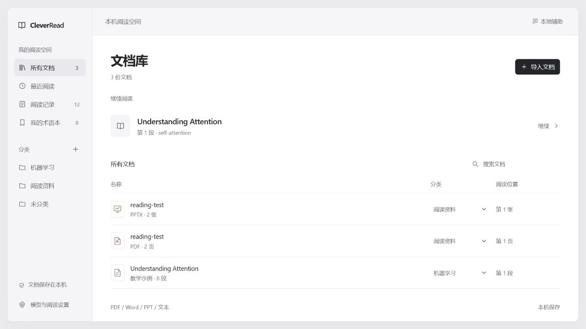
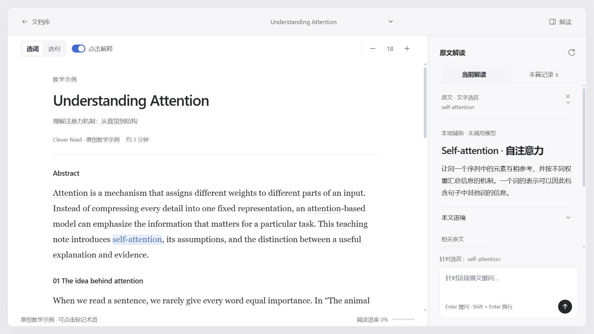
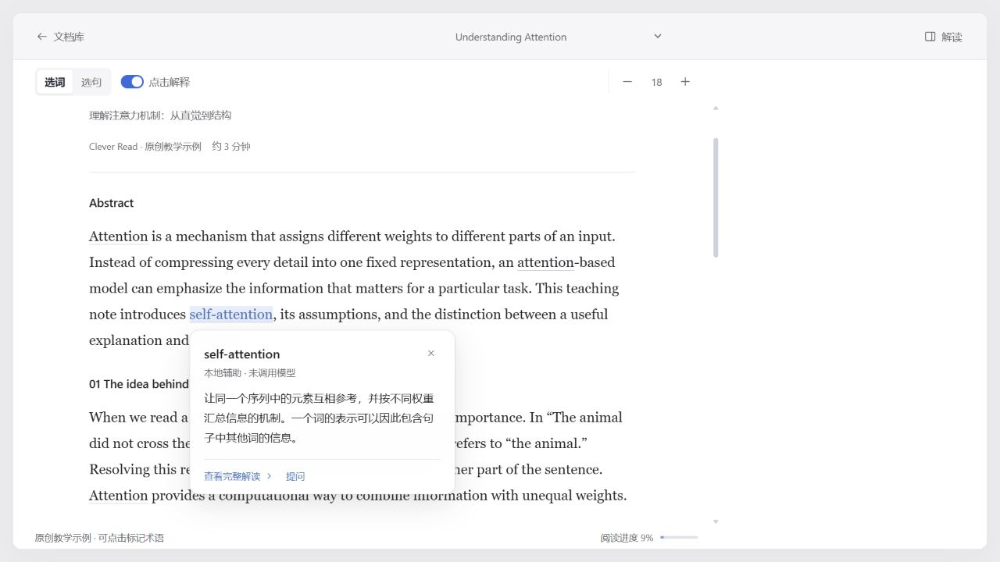
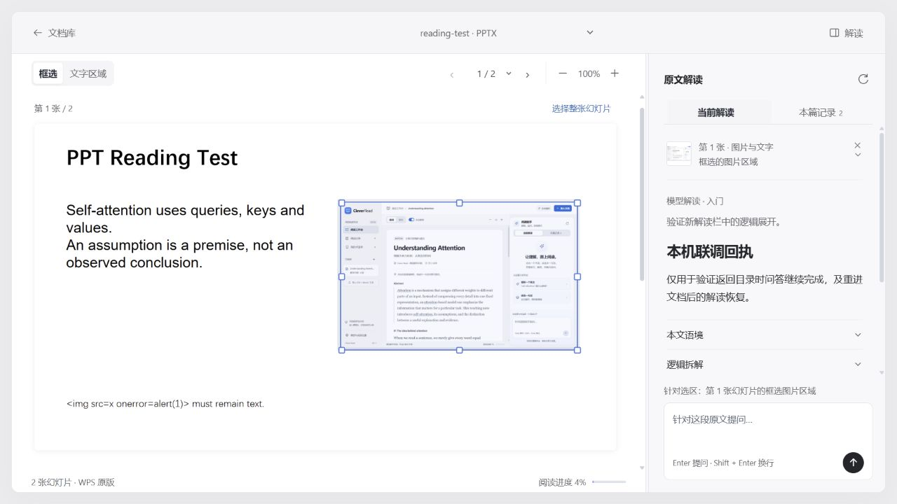
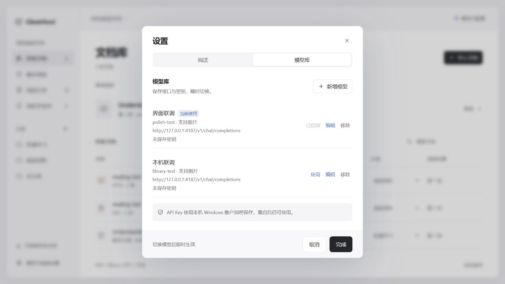

# Clever Read

本地运行的阅读 App：先在文档库归类、选择文档，再进入独立阅读界面，点击词语、选中句子或框选幻灯片内容，随时针对原文提问。





0.5.0 界面使用冷银灰、纸面白和少量蓝色，统一正文、控件与辅助文字的字号层级。文档库提供分类、搜索、最近阅读和「继续阅读」，模型设置、阅读记录和术语本也放在这里。阅读页省去左侧导航，顶部可返回文档库或切换文档，将空间留给正文与原文解读。

解读栏默认宽度为 334px。点击「解读」可收起或展开右栏，保留右侧空间，正文在屏幕中的横向位置、宽度、缩放和滚动位置保持稳定。拖动分隔线可调整解读栏宽度，也支持方向键、Home / End，拖动中按 Esc 可撤回。点击选区的「提问」「解释」或「拆解逻辑」会自动展开解读栏。

返回目录保留分类、搜索和列表位置；继续阅读恢复文档位置、阅读模式、选区、已保存解读和问题草稿。返回目录时正在生成的回答会继续完成；切换到另一份文档会取消当前请求。默认启动进入文档库，可在设置中启用「启动后继续上次阅读」。阅读位置单独保存在本机浏览器，不会在每次滚动时重新保存整份 PDF 或 PPT。

点击词语会在选词旁显示简短解释，可进一步查看完整解读或提问；收起解读栏时也能查词。句子、段落和图片提问使用右侧独立滚动区。回答先展示重点，本文语境和逻辑步骤可按需展开；「拆解逻辑」请求默认展开逻辑部分。原文依据使用紧凑入口，点击返回对应原文。选区预览默认收起，点击可展开核对；提问时显示实际请求状态，并可取消。键盘操作跳过切换动画，并支持系统的「减少动态效果」偏好。



## 启动

Windows 双击 **Start-CleverRead.cmd**，等待浏览器打开。需要 Node.js 22 或更新版本；本机的 Codex 内置 Node 也可用于启动。

也可以在项目目录运行：

```powershell
node server.mjs
```

打开 **http://127.0.0.1:4173**。无须 npm install；PDF.js 和 JSZip 已随项目提供。终端启动时按 Ctrl+C 关闭服务；双击启动器启动的服务在后台运行，关闭浏览器不会停止它。

## 核心使用流程

1. 在文档库点击「导入文档」，选择 PDF、Word `.docx`、PPT `.ppt / .pptx`、TXT 或 Markdown，也可粘贴文本。点击分类旁的「+」创建分类，在文档行中选择归类；更多操作收在行末菜单，在鼠标悬停或键盘聚焦时显示，触屏始终可见。点击文档或「继续阅读」进入阅读页。
2. 在「模型与阅读设置 → 模型库」中新增模型，填写接口地址、模型 ID 和 API 密钥，点击「保存并使用」。接口须兼容 Chat Completions，例如 `https://你的服务/v1/chat/completions`。也可填写基础地址，如 `https://api.deepseek.com` 或 `https://你的服务/v1`，保存时会自动补齐 `/chat/completions`。本机免密模型可使用 `http://127.0.0.1:端口/v1/chat/completions`。
3. 点击词语获取解释，或拖选句子/段落，点击「提问」，输入你的问题。也可切换「选句」，点击自动选中该句。按 Enter 发送问题，Shift + Enter 换行；先选择原文，发送按钮才会启用。
4. 回答使用选区、邻近段落和本地关键词检索找到的相关片段。可以继续追问，或点击来源返回原文。
5. 解读自动保存在「阅读记录」；可加入术语本并导出 Markdown。

## PPT / PPTX 阅读与框选

本机需安装 **Windows 桌面版 WPS（含演示组件）或 Microsoft PowerPoint**。优先使用 WPS，无需同时安装微软 Office。导入后按原始排版显示每张幻灯片，图片、图表和文字一起保留；支持旧版 `.ppt` 和 `.pptx`。文件只交给本机演示软件以只读模式解析，转换临时文件在完成后删除。导入前检查宏/脚本内容；检测到时请先在 WPS 中另存为不含宏的 .pptx。

- 「框选」模式：在幻灯片上拖动框出图片、文字或混合区域，右侧显示紧凑预览，然后输入问题。也可用「选择整张幻灯片」。选框内部可拖动移动，八个边角控制点可调整大小；聚焦选框后，方向键微调、Shift + 方向键每次调整 10 像素、Alt + 方向键调整右边/下边。拖动中按 Esc 撤回本次调整，再按 Esc 取消选区。
- 图片问答：在模型设置中选择支持图片输入的模型，并勾选「此模型支持图片输入」。接口需支持 Chat Completions 的 `image_url` 消息；App 只发送框选区域截图及相关文字。
- 文字模型：切换「文字区域」模式点击完整文字区域，或框选一句话后点击「仅用选区文字提问」。图片中的文字不会冒充已提取的正文。
- 支持上一张、下一张、页码跳转、缩放、追问和阅读记录。静态显示幻灯片，不播放动画、视频或音频。
- 导入时显示本机演示软件已读取的幻灯片数量和进度，完成读取后整理并保存。读取过程中可点击「取消导入」，临时文档和转换文件会清理；取消后可重新选择文件。

如果已安装 WPS 却提示没有演示软件，请确认安装了「WPS 演示」组件，先用 WPS 打开一次 PPT，再重试；仍无法识别时，可修复 WPS 安装以恢复本机自动化接口。



## API Key 模型库

设置分为「阅读」和「模型库」。阅读页调整解释深度、启动续读和模型解读开关；模型库提供配置列表与独立编辑页。点击「新增模型」，填写显示名称、模型 ID、接口地址和 API Key，保持「保存到本机模型库」勾选后点击「保存并使用」。可以新增多组配置、编辑、切换或移除；库中同时显示名称、实际模型 ID、接口地址、图片输入能力及密钥保存状态。切换模型即时生效，修改阅读偏好后点击保存。

Windows 使用当前用户的 **DPAPI** 加密保存到 `.runtime/model-vault.json`，浏览器只收到配置元数据和「密钥已保存」状态。关闭页面、退出服务或重启电脑后，使用同一个 Windows 账户启动即可继续使用。编辑已保存配置时，密钥留空表示保留原密钥；更换接口地址时需输入该接口对应的密钥。

不要将 `.runtime` 上传到 GitHub；此目录已经忽略。非 Windows 平台采用本地 AES-GCM 与仅当前用户可读的密钥文件；PPT 原版读取仍需 Windows 桌面版 WPS 演示或 PowerPoint。取消勾选保存时，密钥仅用于本次页面会话。



DeepSeek 配置：接口填写 `https://api.deepseek.com`，DeepSeek-V4.1-Flash 的 API 模型 ID 填写 `deepseek-flash`，密钥填写 DeepSeek 平台申请的 API Key。App 会在 DeepSeek 官方地址下将展示名称 `DeepSeek-V4.1-Flash` 自动转换为该 API ID，也会修正已保存的同名设置。模型信息以 [DeepSeek 官方文档](https://api-docs.deepseek.com/zh-cn/) 为准。

如果模型调用失败，App 会显示 HTTP 状态及服务商返回的错误详情（密钥会隐藏）。HTTP 400/422 需要检查模型 ID 或参数；HTTP 402 表示余额不足。可点击「检查模型设置」修改后再次提交。

## 未配置模型时

仍可导入、阅读、选择文本和查看相关原文。内置术语库支持部分概念的通用解释；原创教学示例可直接体验。界面明确显示「本地辅助 · 未调用模型」。自由提问不会用预设内容冒充模型回答。

## 文件支持与边界

- **PDF**：最大 30 MB、150 页，需要文字层。支持流式阅读和保留排版的原版阅读，原版按可见页面渲染。
- **Word `.docx`**：正文及表格中的文字以流式阅读展示，基本标题可保留。暂不还原 Word 页码和完整排版；图片、公式对象、脚注、修订标记不保证完整解析。
- **旧版 `.doc`**：请先在 Word/WPS 中另存为 `.docx`。
- **PowerPoint `.ppt / .pptx`**：最大 30 MB、300 张幻灯片；本机需 Windows 桌面版 WPS 演示或 PowerPoint；优先使用 WPS。保留静态排版并支持图片/文字框选提问。加密文件请先移除密码，导出图片总量超过 80 MB 时需拆分文件。
- **TXT / Markdown / 粘贴文本**：以纯文本展示，最多 30 万字符；文件推荐 UTF-8。
- 扫描 PDF 和图片中的文字暂不支持 OCR。双栏 PDF 的流式顺序、连字和复杂公式可能不准确，请切换原版核对。
- 不支持外部检索或跨文档问答；回答来源只在当前文档中查找。

## 本地数据与模型调用

文档与记录保存在当前浏览器的 IndexedDB，不上传云端。PPT 导入通过本机服务交给 WPS 演示或 PowerPoint 渲染；其他格式仍在浏览器中解析。启用模型后，相关文档片段、选区、问题和最多六条追问历史经本机服务发送至所配置的模型服务。PPT 图片提问会额外发送框选截图，后续追问继续携带同一截图。API 密钥默认加密保存在本机模型库，不写入浏览器存储或日志，也不通过配置接口返回给浏览器。接口地址、模型 ID、阅读偏好会保存。

清除站点数据或改用其他浏览器不会保留记录，请及时导出。`localhost` 与 `127.0.0.1` 是不同的浏览器存储来源，建议始终使用同一地址。

本机服务仅监听 `127.0.0.1`，不是可直接公开部署的多用户服务。引用提供核对入口，并不保证模型结论正确。

## 验证

```powershell
npm.cmd run check
npm.cmd test
```

已安装 Windows 桌面版 WPS 时，可额外运行实际导入测试（强制仅使用 WPS）：

```powershell
$env:CLEVER_WPS_TEST='1'
npm.cmd test
Remove-Item Env:CLEVER_WPS_TEST
```

测试覆盖文档分类与搜索、最近阅读排序、位置元数据、上下文检索、文字/矩形选区边界与移动缩放、导入进度的流式解析、取消导入与临时文件清理、密钥库加密和恢复、并发保存、损坏库保护、图片输入格式、模型结果引用过滤和本地接口联调。0.5.0 的 33 项测试全部通过（包含 WPS 实际读取）。浏览器验证目录与阅读页切换、问答不中断、选区和位置恢复、原版 PDF / WPS PPTX、选词弹层、等待与取消、逻辑折叠、栏宽键盘调整、设置分区保存，以及 801px / 390px 窄屏布局；收起解读栏前后核对了正文和 PDF 页面的横向位置、宽度与滚动位置。测试使用 `?test-session=qa` 独立存储与模型库，避免覆盖正常阅读数据；模拟接口只验证请求传递，不代表模型推理效果。

代码结构：`public/app.js` 负责导航、阅读与交互，`public/library.mjs` 负责文档库筛选与元数据，`public/library.css` 负责目录和独立阅读页样式，`public/documents.mjs` 负责 PDF / Word 解析，`public/slides.mjs` 负责幻灯片交互，`presentations.mjs` 与 `scripts/render-presentation.ps1` 负责 WPS / PowerPoint 本机渲染，`vault.mjs` 负责密钥库，`public/core.mjs` 负责检索与结果处理，`server.mjs` 提供本机静态服务与模型接口代理。第三方说明见 `THIRD_PARTY_NOTICES.md`。
