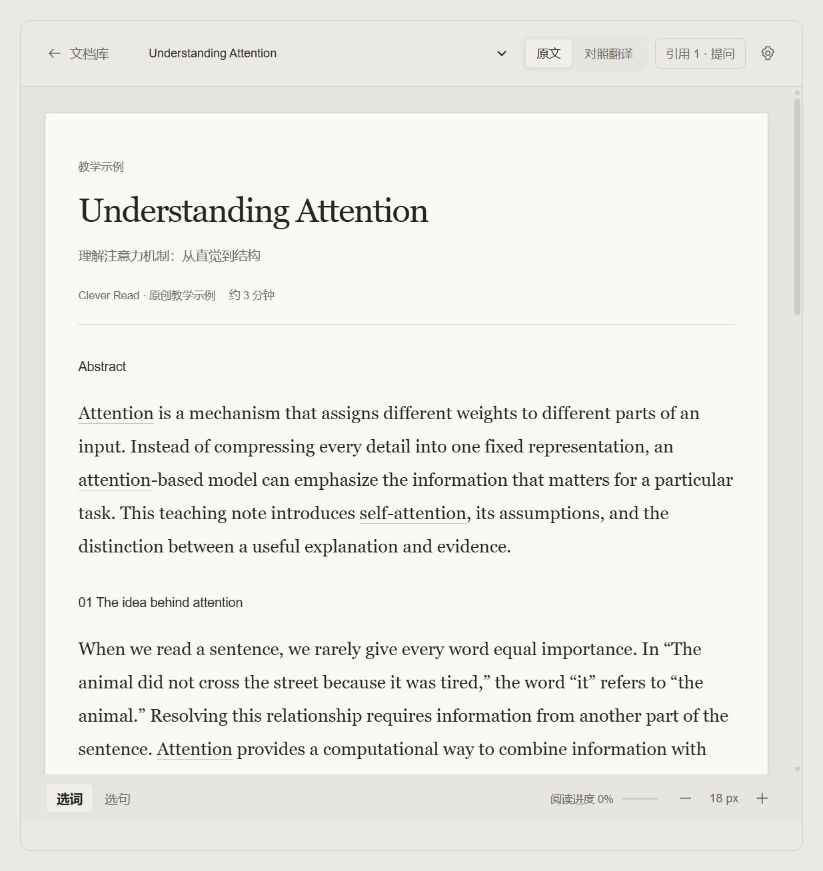

# Clever Read

面向论文与长文本的本地阅读应用。支持在原文中选择词语、句子或幻灯片区域，结合文档上下文解释、拆解逻辑和追问。

解读依据语境确定含义，并可补充原文未定义概念的通用知识。回答区分本文语境与知识补充，提供原文定位以便核对。



## 功能

- 文档分类、搜索与续读；保存阅读位置、选区和问题草稿。
- PDF 原版与流式阅读，Word 正文阅读，PPT 图片与文字区域问答。
- 默认以宽幅正文进入专注阅读；词旁提供短释义，继续解读或追问时移至右侧展开，并复用已有结果。
- 段落与幻灯片区域聚焦；收集最多 4 段原文联合提问，支持原文定位与返回解读。
- 模型回答实时显示；停止或断流保留部分回答、前文和草稿，可重新生成。
- 词旁优先生成简短释义，继续解读时再展开长回答；短释义与完整回答支持按语境缓存，刷新后仍可复用。
- 当前段落或页面按需中英翻译，逐句对照与本机缓存；翻译与解读按任务切换。
- 解读支持公式与表格；独立解读栏可调整宽度，支持停止生成、重新解读、复制与收藏。
- 多模型连接与加密密钥库；配置列表显示模型 ID 和图片输入能力。
- 瑞士排版、编辑档案、经典石墨、纸本四种界面风格；支持深浅背景、字号、行距与动效偏好。
- 文档卡组与快捷续读；页面、解读栏、弹窗和提问反馈采用可中断的连续动效，支持关闭动效和系统减少动态效果设置。
- 阅读记录、术语收藏与 Markdown 导出。

阅读界面采用集中导航、可折叠引用与按需辅助面板。四种既有风格和深浅背景偏好均保留。

## 快速开始

需要 **Node.js 22+**。Windows 双击 `Start-CleverRead.cmd`，或在项目目录运行：

```sh
node server.mjs
```

打开 <http://127.0.0.1:4173>。依赖已随项目提供，无须执行 `npm install`。

1. 导入文档或粘贴文本，在文档库中选择内容开始阅读。
2. 在 **设置 → 模型连接** 中填写接口地址、模型 ID 和 API Key，保存并启用。
3. 点击词语、选择句子或框选幻灯片内容，解释选区或输入问题。Enter 发送，Shift + Enter 换行。

在 **设置 → 外观与阅读** 中预览界面风格与背景，保存后保留；取消恢复原设置。已有深浅背景偏好会自动保留。

## 文件支持

文件最大 30 MB。

| 格式 | 支持范围 |
| --- | --- |
| PDF | 最多 150 页，需文字层；支持原版与流式阅读 |
| Word `.docx` | 解析正文与表格文字，不还原完整排版；`.doc` 需先另存为 `.docx` |
| PPT `.ppt` / `.pptx` | 最多 300 张，保留静态排版；需 Windows 桌面版 WPS 演示或 PowerPoint，优先使用 WPS |
| TXT / Markdown / 粘贴文本 | 纯文本阅读，最多 30 万字符 |

暂不支持 OCR、演示动画、加密或含宏的演示文件，以及跨文档问答。复杂 PDF 排版与公式建议使用原版模式核对。

对照翻译需要连接模型，仅处理当前选段或页面的可提取文字，不翻译图片。PDF 句子无法可靠对应时使用段落或页面定位。联合提问最多包含一张区域截图。服务商未提供流式增量时显示完整响应。

释义缓存按文档、选区、上下文和模型区分，最多保存约 800 条，保留 30 天；可使用“重新生成”刷新。官方 DeepSeek Flash / V4 Pro 的短释义关闭思考模式，深入解读沿用默认设置。当前尚未启用全文自动预读。

## 模型与数据

接口需兼容 Chat Completions；基础地址会自动补齐 `/chat/completions`。模型 ID 以服务商 API 文档为准。图片问答需启用“支持图片输入”，并使用接受 `image_url` 的模型。

API Key 加密保存在本机模型库：Windows 使用当前账户的 DPAPI，其他平台使用 AES-GCM。编辑时密钥留空可保留原值；取消保存则仅用于当前页面会话。未连接模型时，仅提供内置词典和相关原文对照；未收录的词语需连接模型解释。

文档与阅读记录保存在当前浏览器的 IndexedDB。模型问答会向所配置的服务发送选区、相关原文和追问历史；图片问答额外发送选区截图。密钥库位于已被 Git 忽略的 `.runtime/` 目录。本机服务仅监听 `127.0.0.1`。清除浏览器站点数据会移除文档与记录。

## 开发与验证

```sh
npm run check
npm test
```

WPS 集成测试需 Windows 和 WPS 演示，在 PowerShell 中执行：

```powershell
$env:CLEVER_WPS_TEST='1'
npm test
Remove-Item Env:CLEVER_WPS_TEST
```

第三方依赖说明见 [THIRD_PARTY_NOTICES.md](THIRD_PARTY_NOTICES.md)。
