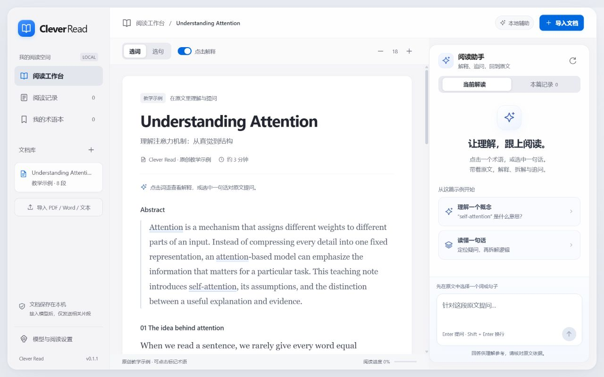

# Clever Read

本地运行的阅读 App：导入文档，在原文中点击词语、选中句子或段落，然后在右侧直接提问。



界面采用浅灰背景、白色阅读纸面和蓝色强调色，提供半透明侧栏、独立阅读助手、滑动分段控件和轻量切换动画。键盘操作跳过切换动画，并支持系统的「减少动态效果」偏好。

## 启动

Windows 双击 **Start-CleverRead.cmd**，等待浏览器打开。需要 Node.js 22 或更新版本；本机的 Codex 内置 Node 也可用于启动。

也可以在项目目录运行：

```powershell
node server.mjs
```

打开 **http://127.0.0.1:4173**。无须 npm install；PDF.js 和 JSZip 已随项目提供。终端启动时按 Ctrl+C 关闭服务；双击启动器启动的服务在后台运行，关闭浏览器不会停止它。

## 核心使用流程

1. 点击「导入文档」，选择 PDF、Word `.docx`、TXT 或 Markdown，也可粘贴文本。
2. 在「模型与阅读设置」中启用真实模型问答，填写接口地址、模型 ID 和 API 密钥。接口须兼容 Chat Completions，例如 `https://你的服务/v1/chat/completions`。也可填写基础地址，如 `https://api.deepseek.com` 或 `https://你的服务/v1`，保存时会自动补齐 `/chat/completions`。本机免密模型可使用 `http://127.0.0.1:端口/v1/chat/completions`。
3. 点击词语获取解释，或拖选句子/段落，点击「提问」，输入你的问题。也可切换「选句」，点击自动选中该句。按 Enter 发送问题，Shift + Enter 换行；先选择原文，发送按钮才会启用。
4. 回答使用选区、邻近段落和本地关键词检索找到的相关片段。可以继续追问，或点击来源返回原文。
5. 解读自动保存在「阅读记录」；可加入术语本并导出 Markdown。

DeepSeek 配置：接口填写 `https://api.deepseek.com`，DeepSeek-V4.1-Flash 的 API 模型 ID 填写 `deepseek-flash`，密钥填写 DeepSeek 平台申请的 API Key。App 会在 DeepSeek 官方地址下将展示名称 `DeepSeek-V4.1-Flash` 自动转换为该 API ID，也会修正已保存的同名设置。模型信息以 [DeepSeek 官方文档](https://api-docs.deepseek.com/zh-cn/) 为准。

如果模型调用失败，App 会显示 HTTP 状态及服务商返回的错误详情（密钥会隐藏）。HTTP 400/422 需要检查模型 ID 或参数；HTTP 402 表示余额不足。可点击「检查模型设置」修改后再次提交。

## 未配置模型时

仍可导入、阅读、选择文本和查看相关原文。内置术语库支持部分概念的通用解释；原创教学示例可直接体验。界面明确显示「本地辅助 · 未调用模型」。自由提问不会用预设内容冒充模型回答。

## 文件支持与边界

- **PDF**：最大 30 MB、150 页，需要文字层。支持流式阅读和保留排版的原版阅读，原版按可见页面渲染。
- **Word `.docx`**：正文及表格中的文字以流式阅读展示，基本标题可保留。暂不还原 Word 页码和完整排版；图片、公式对象、脚注、修订标记不保证完整解析。
- **旧版 `.doc`**：请先在 Word/WPS 中另存为 `.docx`。
- **TXT / Markdown / 粘贴文本**：以纯文本展示，最多 30 万字符；文件推荐 UTF-8。
- 扫描 PDF 和图片中的文字暂不支持 OCR。双栏 PDF 的流式顺序、连字和复杂公式可能不准确，请切换原版核对。
- 不支持外部检索或跨文档问答；回答来源只在当前文档中查找。

## 本地数据与模型调用

文档与记录保存在当前浏览器的 IndexedDB，不上传原始文件。启用模型后，相关文档片段、选区、问题和最多六条追问历史经本机服务发送至所配置的模型服务。API 密钥只保留在本次页面的内存中，不写入浏览器存储或日志，刷新后需重填。接口地址、模型 ID、阅读偏好会保存。

清除站点数据或改用其他浏览器不会保留记录，请及时导出。`localhost` 与 `127.0.0.1` 是不同的浏览器存储来源，建议始终使用同一地址。

本机服务仅监听 `127.0.0.1`，不是可直接公开部署的多用户服务。引用提供核对入口，并不保证模型结论正确。

## 验证

```powershell
npm.cmd run check
npm.cmd test
```

测试覆盖上下文检索、选区边界、模型结果引用过滤和本地接口联调。浏览器测试使用 `?test-session=qa` 独立测试存储，避免覆盖正常阅读数据。

代码结构：`public/app.js` 负责阅读与交互，`public/documents.mjs` 负责 PDF / Word 解析，`public/core.mjs` 负责检索与结果处理，`server.mjs` 提供本机静态服务与模型接口代理。第三方说明见 `THIRD_PARTY_NOTICES.md`。
